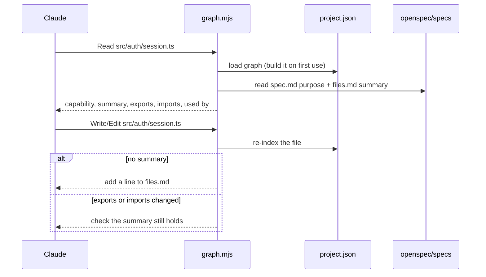
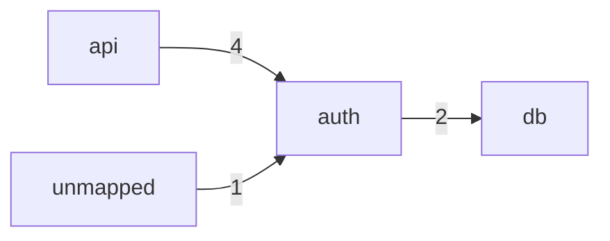

# Code Graph

A map of the codebase that Claude reads before it reads code. It applies the
[summary-details pattern](../docs/patterns/summary-details/REAMDE.md) to the
project itself:

| Layer   | Where                                    | Written by                 |
| ------- | ---------------------------------------- | -------------------------- |
| Summary | `openspec/specs/<capability>/files.md`   | Claude, when the hook asks |
| Facts   | `.claude/graph/project.json`             | `graph.mjs`, automatically |
| Details | the source file                          | you and Claude             |

When Claude opens a file, the hook gives it the file's purpose, the
capability it belongs to, and how it connects to the rest of the code. Claude
can then decide what else it needs to read instead of exploring blindly.

## How it works



### On Read

The hook adds a block like this to Claude's context:

```
[graph] src/auth/session.ts
Capability: auth (openspec/specs/auth/spec.md) — Sign-in and sessions.
Summary: Creates and validates user sessions.
Exports: createSession, validateSession
Imports: src/db/client.ts
Packages: jose
Used by: src/api/login.ts, src/api/logout.ts
```

- Long lists are cut to 8 items, followed by `(+N more)`.
- If the file has no summary, the block ends with the exact line to add and
  the `files.md` to add it to.
- If the file has no summary, its header comment is shown instead.
- On the first read in a project with up to 3000 source files, the whole graph
  is built, so `Used by` is complete from the start. Larger projects show
  `Used by: unknown` until you run `build`.

### On Write / Edit

The hook re-indexes the changed file and stays silent unless something
needs attention:

| Situation                                    | Claude is told                      |
| -------------------------------------------- | ----------------------------------- |
| File has no summary (new or unmapped)        | Add a summary line to `files.md`    |
| Only covered by a directory summary          | Add a file-level summary            |
| Exports or imports changed since the summary | Check the summary still holds       |
| Body changed, exports and imports did not    | Nothing                             |
| A `spec.md` or `files.md` was edited         | Nothing; summaries are re-read      |

Rewording a summary marks it current again.

## Writing summaries

Each capability keeps its file summaries in `files.md` next to its OpenSpec
`spec.md`. They are kept out of `spec.md` so `openspec validate` is not
affected.

```
openspec/
└── specs/
    ├── auth/
    │   ├── spec.md      # Purpose + Requirements (OpenSpec)
    │   └── files.md     # file summaries (code graph)
    └── billing/
        ├── spec.md
        └── files.md
```

`files.md` is a plain list. Each line is a path in backticks, a dash, and one
sentence:

```md
# Files

- `src/auth/` — Everything for login, sessions and tokens.
- `src/auth/session.ts` — Creates and validates user sessions.
- `src/auth/token.ts` — Signs and verifies JWT access tokens.
```

- **Paths** are relative to the project root. A path ending in `/` covers
  everything under that directory.
- **Matching**: a file entry beats a directory entry, and a deeper directory
  beats a shallower one.
- **Separators** `—`, `–`, `-` and `:` are all accepted after the path.
- **The capability purpose** comes from the `## Purpose` section of `spec.md`.

A good summary says what the file is responsible for, not how it works:

| Avoid                                    | Prefer                                         |
| ---------------------------------------- | ---------------------------------------------- |
| Exports createSession and validateSession | Creates and validates user sessions.          |
| Uses jose to sign tokens with HS256      | Signs and verifies JWT access tokens.          |
| Helper functions                         | Formats money and dates for invoices.          |

The exports and packages are already in the graph; the summary should add
the meaning.

## The graph file

`.claude/graph/project.json` is generated and updated by the hooks. Do not
edit it by hand; it is safe to delete, and it is rebuilt on the next read.
Add it to `.gitignore` in projects that use it.

The template ships an empty graph:

```json
{
  "version": 1,
  "complete": false,
  "capabilities": {},
  "files": {},
  "summaries": {},
  "updatedAt": null
}
```

After a build it looks like this:

```json
{
  "version": 1,
  "complete": true,
  "capabilities": {
    "auth": {
      "spec": "openspec/specs/auth/spec.md",
      "files": "openspec/specs/auth/files.md",
      "purpose": "Sign-in and sessions."
    }
  },
  "files": {
    "src/auth/session.ts": {
      "hash": "9de7ad0c5454",
      "header": "Session lifecycle.",
      "imports": ["src/db/client.ts"],
      "packages": ["jose"],
      "exports": ["createSession", "validateSession"],
      "signature": "3ab3bdf82e99"
    }
  },
  "summaries": {
    "src/auth/session.ts": {
      "text": "Creates and validates user sessions.",
      "signature": "3ab3bdf82e99"
    }
  },
  "updatedAt": "2026-11-06T19:08:44.266Z"
}
```

| Field                      | Meaning                                                          |
| -------------------------- | ---------------------------------------------------------------- |
| `version`                  | Format version. Any other value makes the hook start over.       |
| `complete`                 | `true` after a full build; `Used by` is only reliable when true. |
| `capabilities.<name>`      | Paths to the capability's `spec.md` and `files.md`, and its purpose. |
| `files.<path>.hash`        | Content hash, used to skip unchanged files.                      |
| `files.<path>.header`      | The file's leading comment or docstring, up to 280 characters.   |
| `files.<path>.imports`     | Project files this file imports, resolved to real paths.         |
| `files.<path>.packages`    | External packages it imports.                                    |
| `files.<path>.exports`     | Names it exports.                                                |
| `files.<path>.signature`   | Hash of exports + imports: the file's public shape.              |
| `summaries.<path>.text`    | The summary from `files.md`, as last seen.                       |
| `summaries.<path>.signature` | The file's signature when that summary was written.            |
| `updatedAt`                | Time of the last write.                                          |

Dependents (`Used by`) are not stored; they are computed from `imports`.

A summary is **stale** when its text is unchanged but the file's current
`signature` differs from the one recorded with it.

## Commands

Run from the project root:

```sh
node .claude/hooks/graph.mjs build     # rebuild the whole graph
node .claude/hooks/graph.mjs mermaid   # print capability dependencies
```

`build` lists files with `git ls-files` (tracked and untracked, honouring
`.gitignore`), falling back to a directory walk outside git, up to 20000
files.

`mermaid` draws how capabilities depend on each other, with the number of
imports on each edge. Files without a summary are grouped as `unmapped`:



## Coverage

| Language                  | Imports | Exports | Header | Summary |
| ------------------------- | ------- | ------- | ------ | ------- |
| TypeScript / JavaScript   | yes     | yes     | yes    | yes     |
| Vue / Svelte              | yes     | yes     | yes    | yes     |
| Python                    | yes     | yes     | yes    | yes     |
| Go, Rust, Java, Kotlin, C#, Swift, Ruby, PHP | — | — | yes | yes |

Skipped: `node_modules`, `dist`, `build`, `vendor`, `.next`, `coverage`,
`__pycache__`, virtualenvs, and non-code files.

Known limits:

- Imports are found with patterns, not a parser. Path aliases such as
  `@/lib/db` are recorded as packages, not resolved to files.
- Files read or written through Bash are not seen by the hooks.
- The hooks never block a tool call; if one fails, Claude simply gets no
  graph context for that file.
